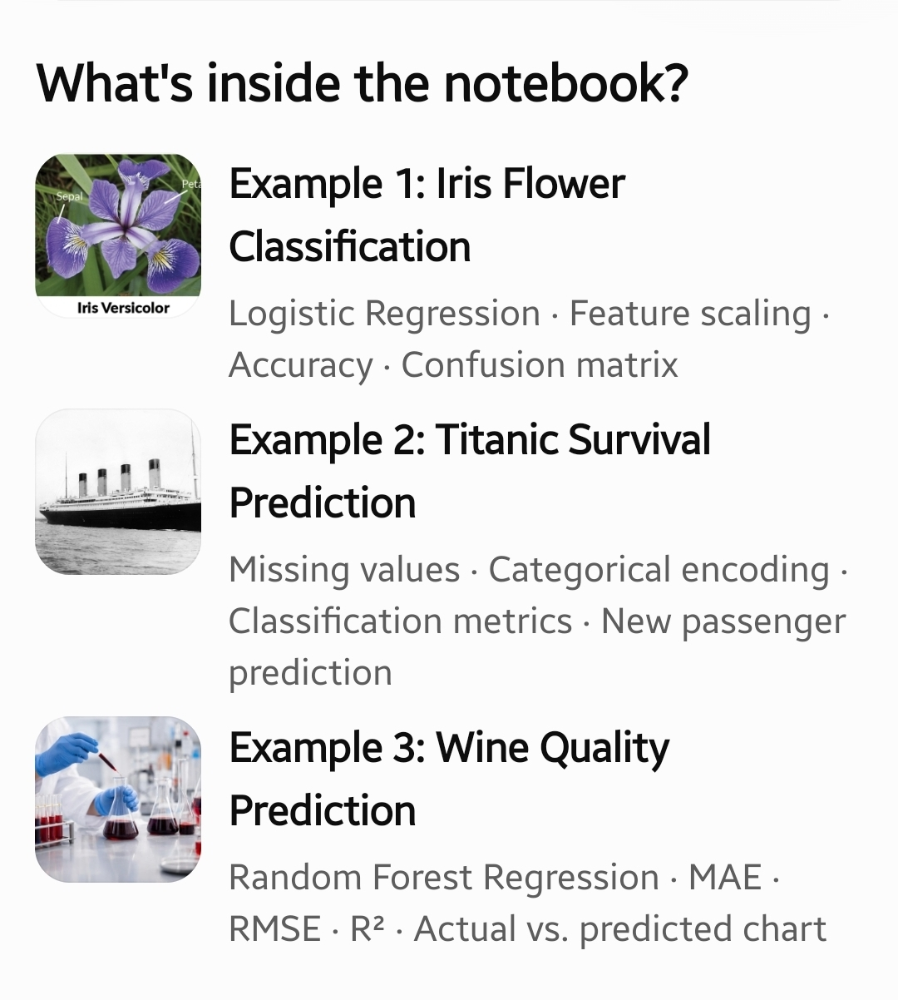
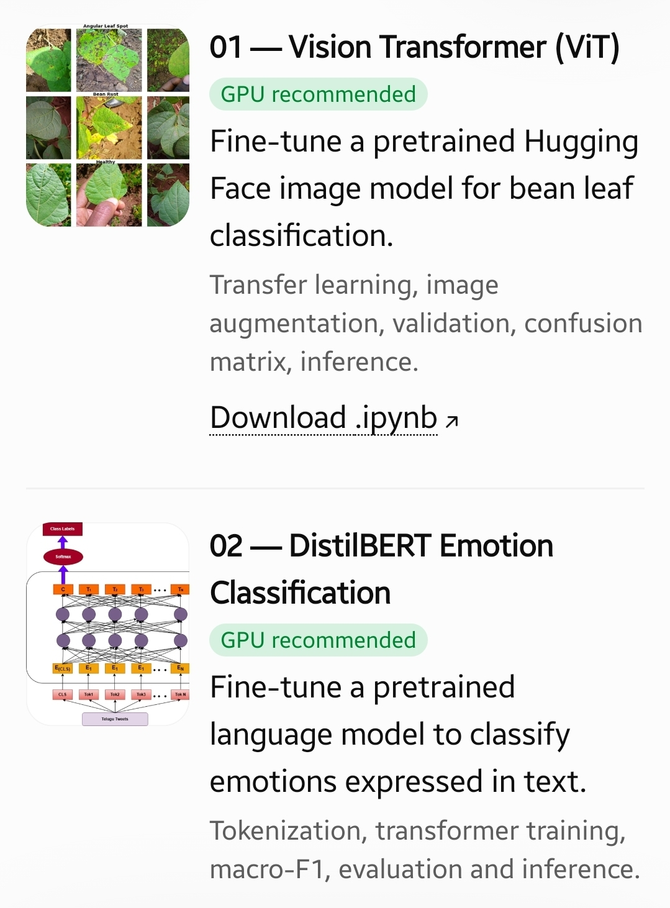
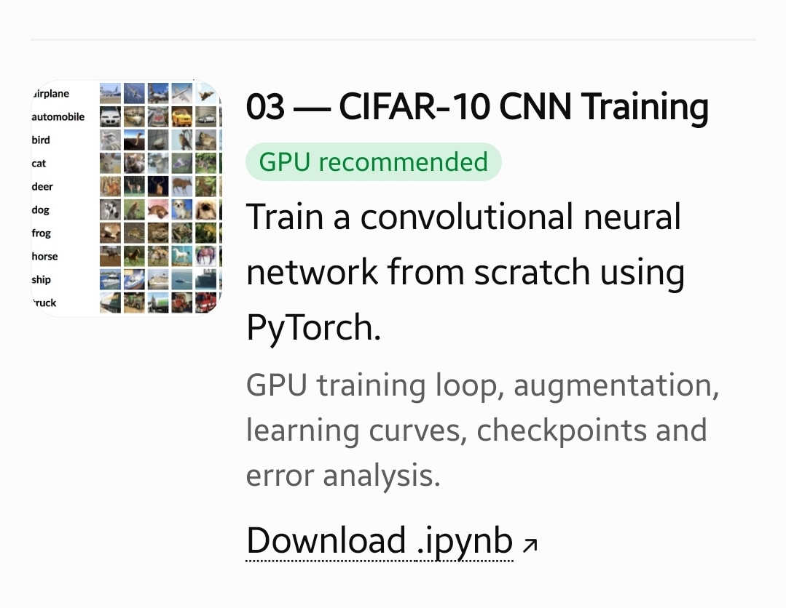

# 🚀 AuraGen 2026 — Machine Learning Workshop & Hackathon

Welcome to the **AuraGen 2026 Machine Learning Workshop** repository! This repository contains learning materials, live demonstrations, sample Jupyter notebooks, and challenge briefs for two learning tracks:

- **Basic ML:** Learn the classical machine-learning workflow and compare traditional algorithms.
- **Advanced ML (GPU recommended):** Explore deep learning, pretrained models, and fine-tuning.

> **Suggested path:** Start with the teaching notes, follow the matching notebook examples, and then attempt the challenge for your track.

## 🧭 Choose your track

| Track | Best for | What you'll practise | Guide |
|---|---|---|---|
| **Basic ML** | Participants learning the ML workflow | Data preparation, classical algorithms, classification, regression, evaluation | [`Jupiter-notebooks/Basic/README.md`](./Jupiter-notebooks/Basic/README.md) |
| **Advanced ML — GPU recommended** | Participants ready to explore deep learning | Transfer learning, transformer fine-tuning, CNN training, deeper evaluation | [`Jupiter-notebooks/Advanced-need-gpu/README.md`](./Jupiter-notebooks/Advanced-need-gpu/README.md) |

## 🖼️ Notebook previews

### Basic ML examples



### Advanced ML examples





## 📚 Repository contents

```text
Auragent---ml-event/
├── README.md
├── 01_What_You_Should_Teach.md
├── 02_Live_Demonstration_Script.md
├── 03_Hackathon_Problem_Statement.md
└── Jupiter-notebooks/
    ├── Basic/
    │   ├── README.md
    │   ├── 01_Iris_Flower_Classification.ipynb
    │   ├── 02_Titanic_Survival_Classification.ipynb
    │   ├── 03_Wine_Quality_Regression.ipynb
    │   └── Images/
    │       └── Simple.jpg
    └── Advanced-need-gpu/
        ├── README.md
        ├── 01_ViT_Bean_Leaf_Image_Classification_GPU.ipynb
        ├── 02_DistilBERT_Emotion_Text_Classification_GPU.ipynb
        ├── 03_CIFAR10_CNN_Train_From_Scratch_GPU.ipynb
        └── Images/
            ├── Advanced-1.jpg
            └── Advanced-2.jpg
```

*The tree above shows the intended structure. Keep filenames and folder capitalization consistent with the actual repository.*

## 🧪 Sample notebooks

### Basic track

1. **Iris Flower Classification** — feature scaling, Logistic Regression, accuracy, and confusion matrix.
2. **Titanic Survival Prediction** — missing-value handling, categorical encoding, classification metrics, and passenger prediction.
3. **Wine Quality Prediction** — regression workflow and prediction evaluation.

Open the [Basic track guide](./Jupiter-notebooks/Basic/README.md) for setup and details.

### Advanced track

1. **ViT Bean Leaf Image Classification** — fine-tune a pretrained Vision Transformer on bean-leaf images.
2. **DistilBERT Emotion Classification** — fine-tune a pretrained transformer for text emotion classification.
3. **CIFAR-10 CNN from Scratch** — train a convolutional neural network on a ten-class image dataset.

Open the [Advanced GPU track guide](./Jupiter-notebooks/Advanced-need-gpu/README.md) for setup, datasets, and evaluation guidance.

## 🧑‍🏫 Workshop materials

- [`01_What_You_Should_Teach.md`](./01_What_You_Should_Teach.md) — concepts and topics to teach.
- [`02_Live_Demonstration_Script.md`](./02_Live_Demonstration_Script.md) — suggested sequence for the live demonstration.
- [`03_Hackathon_Problem_Statement.md`](./03_Hackathon_Problem_Statement.md) — participant challenge and expected deliverables.

## 🎯 Hackathon challenges

### Basic ML challenge
Train and compare **two classical machine-learning algorithms** on a suitable dataset. Use a fair evaluation setup, report relevant metrics, and explain which model performs better and why.

### Advanced ML challenge
Fine-tune a **pretrained image or text model**. Explain the model and dataset choices, preprocessing, evaluation metrics, results, limitations, and possible improvements. A GPU is recommended for practical training times.

## ⚙️ Where to run the notebooks

- **Google Colab:** Upload or open a notebook in Colab. For advanced notebooks, select a GPU runtime when available.
- **Local Jupyter:** Install the dependencies listed in the notebook and run the cells from top to bottom.

Always follow the installation and dataset instructions inside each notebook. Package versions, compute availability, and training time may vary by environment.

## 📏 Evaluation mindset

A strong submission should do more than achieve a high score. Participants should:

- Explain the dataset and target clearly.
- Keep training, validation, and test data roles separate.
- Choose metrics appropriate to the task and class balance.
- Compare models fairly and interpret the results.
- Discuss limitations, possible data leakage, overfitting, and next steps.
- Make the notebook readable and reproducible.

## 🔗 Dataset references

- [Beans image dataset — Hugging Face](https://huggingface.co/datasets/AI-Lab-Makerere/beans)
- [Emotion text dataset — Hugging Face](https://huggingface.co/datasets/dair-ai/emotion)
- [CIFAR-10 dataset — University of Toronto](https://www.cs.toronto.edu/~kriz/cifar.html)

The CIFAR-10 notebook downloads the dataset using `torchvision.datasets.CIFAR10`; a Kaggle account is not required for that notebook. Check dataset and model terms before redistributing or deploying trained models.

## 🙌 Final note

Use the Basic track to build a solid foundation, then explore the Advanced track to practise modern deep-learning workflows. Keep your experiments reproducible, justify your decisions, and focus on what the evaluation tells you—not just the final score.

**AuraGen 2026 · Machine Learning Workshop & Hackathon**
